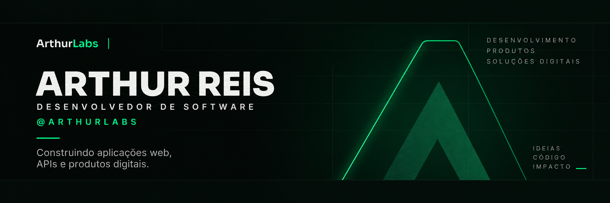

 

## Arthur Reis

**Desenvolvedor de Software @ArthurLabs**

Atuo no desenvolvimento de aplicações web e produtos digitais, trabalhando entre frontend, backend e integração de serviços.

Minha stack principal é baseada em **React, TypeScript e Node.js**, com experiência prática na construção de interfaces, APIs REST, autenticação, integração com bancos de dados e organização de aplicações web.

Atualmente também desenvolvo projetos na **ArthurLabs**, participando da concepção, desenvolvimento e publicação de soluções digitais.

---

## Stack

### Frontend

  

**TypeScript · React · Next.js **

### Backend

  

**Node.js · PostgreSQL **

### Qualidade e infraestrutura

  

**Jest · Docker · Linux · CI/CD **

---

## Contato

  

  

<!--
Substitua:
- LINKEDIN_URL pelo seu LinkedIn.
- ARTHURLABS_URL pelo site/perfil da ArthurLabs.
-->
