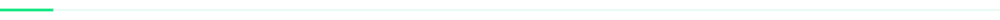

  

 

<samp>OLÁ, EU SOU O</samp>

<h1>Arthur 👋</h1>

  Sou desenvolvedor de software e trabalho com aplicações web, no frontend e no backend.
  Uso principalmente <strong>React, TypeScript e Node.js</strong> para construir interfaces,
  desenvolver APIs REST e integrar bancos de dados e serviços.

  Também tenho experiência com autenticação, testes com Jest e publicação de aplicações
  usando Docker, Linux e CI/CD.

 

  <samp>TECNOLOGIAS</samp> 
  Ferramentas que fazem parte da minha rotina.

<table width="100%">
  <thead>
    <tr>
      <th align="left" width="33%">Frontend</th>
      <th align="left" width="29%">Backend</th>
      <th align="left" width="38%">Ferramentas &amp; outros</th>
    </tr>
  </thead>
  <tbody>
    <tr>
      <td valign="top">
        <table>
          <tr>
            <td>&nbsp; React</td>
            <td>&nbsp; TypeScript</td>
          </tr>
          <tr>
            <td colspan="2">&nbsp; Next.js</td>
          </tr>
        </table>
      </td>
      <td valign="top">
        <table>
          <tr>
            <td>&nbsp; Node.js</td>
          </tr>
          <tr>
            <td>&nbsp; PostgreSQL</td>
          </tr>
        </table>
      </td>
      <td valign="top">
        <table>
          <tr>
            <td>&nbsp; Docker</td>
            <td>&nbsp; Jest</td>
          </tr>
          <tr>
            <td>&nbsp; Linux</td>
            <td>CI/CD</td>
          </tr>
        </table>
      </td>
    </tr>
  </tbody>
</table>

 

<table width="100%">
  <tr>
    <td valign="top" width="40%">
      
<samp>ATUALMENTE</samp>

      
Desenvolvendo aplicações web e APIs.

      <a href="https://github.com/buildwitharthur?tab=repositories"><strong>Meus projetos &rarr;</strong></a>
    </td>
    <td valign="top" width="30%">
      
<samp>CONECTE-SE</samp>

      <a href="https://github.com/buildwitharthur">@buildwitharthur</a>
    </td>
    <td align="right" valign="middle" width="30%">
      
<em>“Disciplina hoje, liberdade amanhã.”</em>

    </td>
  </tr>
</table>
